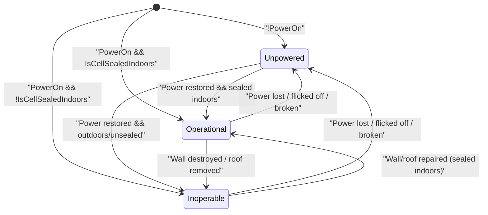

# Vacuum Chamber — Detailed Specification

## 1. Overview & Mod Identity

**Vacuum Chamber** is a RimWorld (`1.7`) mod built on the vacuum mechanics introduced in the **Odyssey** DLC. It adds a researchable, Spacer-tier, stuff-selectable `1x1` rotatable building that evacuates or pressurizes an enclosed indoor room (region) to maintain a controlled partial or full vacuum using ISO 3529 vacuum technology formulas.

| Attribute | Value |
| :--- | :--- |
| **Mod Name** | Vacuum Chamber |
| **Package ID** | `hiroakiyamamoto.VacuumChamber` |
| **Target RimWorld Version** | `1.7` (verified against `1.7.5021`) |
| **Target Framework** | `.NET 10.0` (`Krafs.Rimworld.Ref` `1.7.5014-unstable`) |
| **Required DLC** | `Ludeon.RimWorld.Odyssey` (Odyssey) |
| **Dependencies** | `brrainz.harmony` (`Lib.Harmony` `3.0.0-rc.8`) |
| **Supported Languages** | `English`, `Japanese`, `ChineseTraditional` |
| **Source Project** | [VacuumChamber.csproj](../../VacuumChamber/VacuumChamber.csproj) |
| **Primary Requirements** | [requirements.md](./requirements.md) |

---

## 2. Directory Layout & Required Resources

### 2.1 Mod Package Structure

```text
VacuumChamber/ (Mod Root)
├── About/
│   └── About.xml
├── LICENSE.md
├── LoadFolders.xml
├── VacuumChamber.slnx
├── 1.7/
│   ├── Assemblies/
│   │   └── VacuumChamber.dll
│   └── Defs/
│       ├── ResearchProjectDefs/
│       │   └── ResearchProjects_VacuumChamber.xml
│       └── ThingDefs_Buildings/
│           └── Buildings_VacuumChamber.xml
├── Textures/
│   ├── Things/
│   │   └── Building/
│   │       └── VacuumChamber/
│   │           ├── VacuumChamber_MenuIcon.png
│   │           ├── Unpowered/
│   │           │   ├── VacuumChamber_Unpowered_{north,east,south,west}.png
│   │           │   └── VacuumChamber_Unpowered_{north,east,south,west}m.png
│   │           ├── Operational/
│   │           │   ├── VacuumChamber_Operational_{north,east,south,west}.png
│   │           │   └── VacuumChamber_Operational_{north,east,south,west}m.png
│   │           └── Inoperable/
│   │               ├── VacuumChamber_Inoperable_{north,east,south,west}.png
│   │               └── VacuumChamber_Inoperable_{north,east,south,west}m.png
│   └── UI/
│       └── Commands/
│           ├── VacuumChamber_SetVacuumLevel.png
│           └── VacuumChamber_SetPumpingSpeed.png
├── Languages/
│   ├── English/
│   │   ├── DefInjected/
│   │   │   ├── ResearchProjectDef/ResearchProjects_VacuumChamber.xml
│   │   │   └── ThingDef/Buildings_VacuumChamber.xml
│   │   └── Keyed/
│   │       └── VacuumChamber_Keys.xml
│   ├── Japanese/
│   │   ├── DefInjected/
│   │   │   ├── ResearchProjectDef/ResearchProjects_VacuumChamber.xml
│   │   │   └── ThingDef/Buildings_VacuumChamber.xml
│   │   └── Keyed/
│   │       └── VacuumChamber_Keys.xml
│   └── ChineseTraditional/
│       ├── DefInjected/
│       │   ├── ResearchProjectDef/ResearchProjects_VacuumChamber.xml
│       │   └── ThingDef/Buildings_VacuumChamber.xml
│       └── Keyed/
│           └── VacuumChamber_Keys.xml
├── VacuumChamber/ (C# Solution Source)
│   ├── VacuumChamber.csproj
│   ├── Building_VacuumChamber.cs
│   ├── ChamberState.cs
│   ├── ChamberTextures.cs
│   ├── CompProperties_VacuumChamber.cs
│   ├── CompVacuumChamber.cs
│   ├── Dialog_ChamberValue.cs
│   ├── MapComponent_VacuumTracker.cs
│   ├── PlaceWorker_VacuumChamber.cs
│   ├── RoomSealUtility.cs
│   ├── VacuumChamberMod.cs
│   ├── VacuumPatches.cs
│   └── VacuumPhysics.cs
└── VacuumChamber.Tests/
    └── VacuumPhysicsTests.cs
```

> [!NOTE]
> [VacuumChamber.csproj](../../VacuumChamber/VacuumChamber.csproj) outputs `Release` builds to `..\$(Version)\Assemblies\` (`1.7/Assemblies/VacuumChamber.dll`), matching `LoadFolders.xml`.

### 2.2 Mod Metadata Files

- **`About/About.xml`**:
  - `<name>Vacuum Chamber</name>`
  - `<authors>`: `Hiroaki Yamamoto`, `Gemini`
  - `<packageId>hiroakiyamamoto.VacuumChamber</packageId>`
  - `<supportedVersions><li>1.7</li></supportedVersions>`
  - `<modDependencies>`:
    - `Ludeon.RimWorld.Odyssey` (Odyssey)
    - `brrainz.harmony` (Harmony)
  - `<loadAfter>`:
    - `Ludeon.RimWorld.Odyssey`
    - `brrainz.harmony`
- **`LoadFolders.xml`**:
  - Under `<v1.7>`: loads `/` (root shared assets: `Textures/`, `Languages/`) and `1.7` (versioned `Assemblies/` and `Defs/`).

### 2.3 Texture Assets & Visual Design

1. **Object Textures (`Graphic_Multi`, 4 cardinal directions)**:
   - Because the Vacuum Chamber is rotatable and stuff-selectable, every visual state uses directional sprites (`_north`, `_east`, `_south`, `_west`) and `_m` mask sprites (`_northm`, `_eastm`, `_southm`, `_westm`) loaded via `Graphic_Multi`.
   - Uses `ShaderTypeDefOf.CutoutComplex` with `_m` mask textures so selected metallic stuff tints the outer chassis (`DrawColor`) while preserving indicator lights and vents (`DrawColorTwo`).
   - **Visual States**:
     - **Unpowered** (`VacuumChamber_Unpowered`): Darkened indicators, closed/idle intake louvers.
     - **Operational** (`VacuumChamber_Operational`): Lit cyan/blue Spacer-tier indicator accents, active intake grille.
     - **Inoperable** (`VacuumChamber_Inoperable`): Amber/red warning indicator showing an unsealed/outdoor room condition.
   - **Aesthetic Direction**: References RimWorld Spacer-tier structures (`OrbitalScanner`, `MultiAnalyzer`, `VitalsMonitor`, `Ship_*`) with chamfered metallic/composite housing, recessed vents, and high-tech status panels consistent with Odyssey orbital hardware.
   - **Menu Icon**: `Textures/Things/Building/VacuumChamber/VacuumChamber_MenuIcon.png` for the Architect menu and minified item representation.
2. **Command Button Textures**:
   - `Textures/UI/Commands/VacuumChamber_SetVacuumLevel.png` — Gizmo icon to open the Target Vacuum Level dialog.
   - `Textures/UI/Commands/VacuumChamber_SetPumpingSpeed.png` — Gizmo icon to open the Pumping Speed Level dialog.

### 2.4 Localization Files

Complete translations are provided in `English`, `Japanese`, and `ChineseTraditional` (`Languages/<Lang>/`):
- **`DefInjected/ResearchProjectDef/ResearchProjects_VacuumChamber.xml`**: `label`, `description` for `VC_VacuumChamber`.
- **`DefInjected/ThingDef/Buildings_VacuumChamber.xml`**: `label`, `description` for `VC_VacuumChamber`.
- **`Keyed/VacuumChamber_Keys.xml`**:
  - Gizmo labels and tooltips (`VC_SetVacuumLevel_Label`, `VC_SetVacuumLevel_Desc`, `VC_SetPumpingSpeed_Label`, `VC_SetPressurizationSpeed_Label`, `VC_SetPumpingSpeed_Desc`)
  - Dialog labels (`VC_Dialog_TargetVacuumTitle`, `VC_Dialog_PumpingSpeedTitle`, `VC_Dialog_PressurizationSpeedTitle`, `VC_Dialog_TargetSummary`, `VC_Dialog_SpeedSummary`, `VC_Dialog_Confirm`, `VC_Dialog_Cancel`)
  - Inspect pane strings (`VC_State_Operational`, `VC_State_Unpowered`, `VC_State_Inoperable`, `VC_Inspect_TargetVacuum`, `VC_Inspect_RoomVacuum`, `VC_Inspect_RoomVacuumOutdoors`, `VC_Inspect_PumpingSpeed`, `VC_Inspect_PressurizationSpeed`)
  - Placement rejection reasons (`VC_CannotPlaceOnWater`, `VC_MustPlaceIndoors`)

---

## 3. Game Definitions (XML Defs)

### 3.1 Research Definition (`ResearchProjectDef`)

Defined in `1.7/Defs/ResearchProjectDefs/ResearchProjects_VacuumChamber.xml`:

- **`defName`**: `VC_VacuumChamber`
- **`label`**: `vacuum chamber`
- **`techLevel`**: `Spacer`
- **`prerequisites`**:
  - `<li>AirConditioning</li>`
- **`requiredResearchBuilding`**: `HiTechResearchBench`
- **`requiredResearchFacilities`**:
  - `<li>MultiAnalyzer</li>`
- **`baseCost`**: `2000`
- **`researchViewX` / `researchViewY`**: `16.00` / `2.40` (placed on the `Main` research tab without overlapping Core or Odyssey nodes).

### 3.2 Building Definition (`ThingDef`)

Defined in `1.7/Defs/ThingDefs_Buildings/Buildings_VacuumChamber.xml`:

- **`ParentName`**: `BuildingBase`
- **`defName`**: `VC_VacuumChamber`
- **`thingClass`**: `VacuumChamber.Building_VacuumChamber`
- **`label`**: `vacuum chamber`
- **`size`**: `(1,1)`
- **`rotatable`**: `true`
- **`defaultPlacingRot`**: `South`
- **`tickerType`**: `Rare` (`TickRare()` runs every `250` ticks = `0.1` in-game hours)
- **`drawerType`**: `MapMeshOnly` (re-meshes via `DirtyMapMesh(Map)` on state transitions with zero per-frame draw overhead)
- **`altitudeLayer`**: `Building`
- **`passability`**: `PassThroughOnly` (`pathCost = 40`, `fillPercent = 0.5`)
- **`castEdgeShadows`**: `false`
- **`minifiedDef`**: `MinifiedThing` (`thingCategories`: `<li>BuildingsMisc</li>`)
- **`designationCategory`**: `Odyssey` (`uiOrder = 2510`, grouped with `OxygenPump` and `VacBarrier`)
- **`researchPrerequisites`**: `<li>VC_VacuumChamber</li>`
- **`constructionSkillPrerequisite`**: `6`
- **`uiIconPath`**: `Things/Building/VacuumChamber/VacuumChamber_MenuIcon`
- **`graphicData`**:
  - `graphicClass`: `Graphic_Multi`
  - `texPath`: `Things/Building/VacuumChamber/Unpowered/VacuumChamber_Unpowered` (default base graphic; runtime `Building_VacuumChamber.Graphic` selects the active state's `Graphic_Multi`)
  - `shaderType`: `CutoutComplex`
  - `drawSize`: `(1,1)`
  - `damageData.enabled`: `false`
- **`building.destroySound`**: `BuildingDestroyed_Metal_Small`

#### Stat Bases (`<statBases>`)

- **`MaxHitPoints`**: `150`
- **`WorkToBuild`**: `3500`
- **`Mass`**: `25`
- **`Flammability`**: `0.2`
- **`Beauty`**: `-4`

#### Manufacturing Material (`Stuff`) & Cost

- **`stuffCategories`**:
  - `<li>Metallic</li>` (allows Steel, Plasteel, Uranium, Gold, Silver, etc., tinting the housing)
- **`costStuffCount`**: `60`
- **`costList`**:
  - `ComponentIndustrial`: `3`
  - `ComponentSpacer`: `1`

#### Terrain Independence

To satisfy indoor placement on any non-water tile regardless of foundation presence, flooring, fertility, or plantability:
- **`<terrainAffordanceNeeded IsNull="True" />`**
- **`<useStuffTerrainAffordance>false</useStuffTerrainAffordance>`** (prevents selected `Metallic` stuff from re-introducing a `Medium` or `Heavy` terrain affordance check)

#### Components (`<comps>`)

1. `CompProperties_Power`:
   - `compClass`: `CompPowerTrader`
   - `basePowerConsumption`: `250` (Level 1 baseline; dynamically set to `-250f * pumpingSpeedLevel` at runtime)
   - `shortCircuitInRain`: `true`
2. `CompProperties_Flickable`
3. `CompProperties_Breakdownable`
4. `VacuumChamber.CompProperties_VacuumChamber`:
   - `ceilingHeightMeters`: `2.5f`
   - `pumpingSpeedPerLevel`: `100f` (`m³/h`)
   - `powerPerSpeedLevel`: `250f` (`W`)
   - `maxPumpingSpeedLevel`: `50` (`int`)
   - `defaultPumpingSpeedLevel`: `1` (`int`)
   - `defaultTargetVacuum`: `0` (`int`, `0%`)
   - `unpoweredTexPath`: `Things/Building/VacuumChamber/Unpowered/VacuumChamber_Unpowered`
   - `operationalTexPath`: `Things/Building/VacuumChamber/Operational/VacuumChamber_Operational`
   - `inoperableTexPath`: `Things/Building/VacuumChamber/Inoperable/VacuumChamber_Inoperable`

#### PlaceWorkers

- `VacuumChamber.PlaceWorker_VacuumChamber`

---

## 4. Functional & Behavioral Specification

### 4.1 Placement Rules (`PlaceWorker_VacuumChamber`)

`AllowsPlacing(BuildableDef checkingDef, IntVec3 loc, Rot4 rot, Map map, Thing? thingToIgnore = null, Thing? thing = null)` validates bounds (`map == null || !loc.InBounds(map)` returns `false`) and allows placement if and only if **both** rules hold:

1. **Not on Water**:
   - Query `TerrainDef? terrain = loc.GetTerrain(map)`.
   - Reject with `VC_CannotPlaceOnWater` if `terrain == null || terrain.IsWater`.
2. **Indoors (Sealed Room)**:
   - Delegate to `RoomSealUtility.IsCellSealedIndoors(loc, map, out _)`.
   - Require `map.roofGrid.Roofed(loc)` and `RoomSealUtility.IsRoomSealedIndoors(room)`:
     `room != null && !room.Dereferenced && !room.PsychologicallyOutdoors && !room.TouchesMapEdge && room.OpenRoofCount == 0`.
   - Reject with `VC_MustPlaceIndoors` if any condition fails.
3. **Ignored Terrain Factors**:
   - Foundation presence, flooring, soil fertility, and plantability are never checked and never block placement.

### 4.2 Operating State Machine & Visual Priority

At spawn, on `CompTickRare()`, on power/flick/breakdown signals (`CompPowerTrader.PowerTurnedOnSignal`, `CompPowerTrader.PowerTurnedOffSignal`, `CompFlickable.FlickedOnSignal`, `CompFlickable.FlickedOffSignal`, `CompBreakdownable.BreakdownSignal`), and when room geometry/roof changes (`Room.Notify_RoofChanged`, `Room.Notify_RoomShapeChanged`), each chamber evaluates its `ChamberState` via `VacuumPhysics.EvaluateState`:



#### Evaluation Priority Table

| Priority | State | Condition | Depressurizes / Pressurizes? | Graphic |
| :---: | :--- | :--- | :---: | :--- |
| **1 (Highest)** | `Unpowered` | `powerComp == null \|\| !powerComp.PowerOn` | No | `Unpowered` |
| **2** | `Inoperable` | `PowerOn` and cell/room is not sealed indoors (`!map.roofGrid.Roofed(Position) \|\| room == null \|\| room.Dereferenced \|\| room.PsychologicallyOutdoors \|\| room.TouchesMapEdge \|\| room.OpenRoofCount > 0`) | No | `Inoperable` |
| **3** | `Operational` | `PowerOn` and cell is roofed inside a sealed indoor room | Yes | `Operational` |

- **Overlap Priority Rule**: Whenever `Unpowered` overlaps with `Inoperable` (e.g., room wall breached while unpowered), **`Unpowered` takes priority**.
- **Automatic Recovery**: When walls or roofs are rebuilt and the room becomes sealed indoors again while powered, the chamber automatically transitions back to `Operational` and resumes vacuum regulation.
- **Mesh Refresh & Color Caching**: Only when `CurrentState` changes (or `forceDirtyMesh == true`), `CompVacuumChamber.RefreshState` calls `parent.DirtyMapMesh(parent.Map)` so the cached `Graphic_Multi` re-renders in $O(1)$ without per-frame polling. `Building_VacuumChamber.EnsureStateGraphics` caches `DrawColor` and `DrawColorTwo`, refreshing the three state `Graphic_Multi` instances only if colors change.

### 4.3 Power Consumption

- Power draw scales linearly with `pumpingSpeedLevel` ($L_{\text{speed}} \in [1, 50]$):
  $$P_{\text{draw}} = 250 \times L_{\text{speed}}\text{ [W]}$$
- Range: `250 W` (Level `1`) to `12,500 W` (Level `50`).
- Applied via `CompPowerTrader.PowerOutput = -VacuumPhysics.ComputePowerDrawWatts(pumpingSpeedLevel, Props.powerPerSpeedLevel)` on `PostSpawnSetup`, on `ReceiveCompSignal` (power/flick/breakdown signals), on `CompTickRare()`, and immediately when `pumpingSpeedLevel` is confirmed in `Dialog_ChamberValue`.

### 4.4 Depressurization & Pressurization Physics (ISO 3529 Model)

Chamber pressure regulation runs inside `CompTickRare()` **only** when `CurrentState == ChamberState.Operational` and `parent.Spawned && parent.Map != null`:
1. Verifies `RoomSealUtility.IsCellSealedIndoors(parent.Position, parent.Map, out Room? room)` and reads `currentVacuum = RoomSealUtility.GetRawVacuum(room)`.
2. On planetary maps (`!parent.Map.Biome.inVacuum`), if `currentVacuum > 0f`, calls `tracker?.RegisterRoom(room)` before the target-equality early return so active depressurized rooms remain tracked.
3. If `currentVacuum == TargetVacuumFraction`, returns without modifying `room.Vacuum`.
4. Otherwise, computes `nextVacuum` and assigns `room.Vacuum = nextVacuum`:
   - **Depressurization**: when `currentVacuum < TargetVacuumFraction`.
   - **Pressurization**: when `currentVacuum > TargetVacuumFraction`, reinterpreting `pumpingSpeedLevel` as the **Pressurization speed level**.
5. On planetary maps, calls `tracker?.RegisterRoom(room)` if `nextVacuum > 0f`, or `tracker?.UnregisterRoom(room)` when `nextVacuum <= 0f`.

#### Physical Constants & Variables

- **Room Volume ($V$)**:
  - Assuming 1 tile $= 1\text{ m}^2$ and ceiling height $h = 2.5\text{ m}$:
    $$V = \text{room.CellCount} \times 2.5\text{ [m}^3\text{]}$$
- **Pumping / Pressurization Speed ($S$)**:
  $$S = 100 \times L_{\text{speed}}\text{ [m}^3\text{/h]}$$
  - Default ($L_{\text{speed}} = 1$): $100\text{ m}^3\text{/h}$.
  - Maximum ($L_{\text{speed}} = 50$): $5{,}000\text{ m}^3\text{/h}$.
- **In-Game Time Step ($\Delta t_h$)**:
  - `GenDate.TicksPerHour = 2500` ticks.
  - Per `TickRare` (`GenTicks.TickRareInterval = 250` ticks):
    $$\Delta t_h = \frac{250}{2500} = 0.1\text{ [h]}$$

#### ISO 3529-1 Evacuation Derivation (`currentVacuum < targetVacuum`)

By ISO 3529-1, volume flow rate (pumping speed) at constant temperature for an ideal gas in a rigid vessel of volume $V$ satisfies:

$$S = -\frac{V}{p}\frac{dp}{dt} \implies p(t + \Delta t_h) = p(t)\exp\!\left(-\frac{S}{V}\Delta t_h\right)$$

Mapping relative pressure $p / p_{\text{atm}}$ to RimWorld's vacuum level $v \in [0.0, 1.0]$ (`0%` to `100%`), where $v = 1 - p / p_{\text{atm}}$:

$$1 - v_{\text{next}} = (1 - v_{\text{cur}})\exp\!\left(-\frac{S}{V}\Delta t_h\right)$$

$$v_{\text{next}} = 1 - (1 - v_{\text{cur}})\exp\!\left(-\frac{S}{V}\Delta t_h\right)$$

#### ISO 3529-1 Pressurization Derivation (`currentVacuum > targetVacuum`)

By ISO 3529-1 conductance / throughput definition ($q_{pV} = C(p_{\text{atm}} - p)$) with effective volumetric pressurization speed $C = S$ admitting atmospheric reference gas at $p_{\text{atm}}$ into the rigid vessel of volume $V$:

$$V\frac{dp}{dt} = S\bigl(p_{\text{atm}} - p(t)\bigr) \implies p_{\text{atm}} - p(t + \Delta t_h) = \bigl(p_{\text{atm}} - p(t)\bigr)\exp\!\left(-\frac{S}{V}\Delta t_h\right)$$

Using $v = 1 - p / p_{\text{atm}} = (p_{\text{atm}} - p) / p_{\text{atm}}$:

$$v_{\text{next}} = v_{\text{cur}}\exp\!\left(-\frac{S}{V}\Delta t_h\right)$$

#### Clamping, Convergence & Multi-Chamber Composition

1. **Target Bounds**:
   - Depressurization: $v_{\text{final}} = \min(v_{\text{next}}, v_{\text{target}})$ (never overshoots `targetVacuum`).
   - Pressurization: $v_{\text{final}} = \max(v_{\text{next}}, v_{\text{target}})$ (never undershoots `targetVacuum`).
2. **Asymptotic Snap**:
   If $|v_{\text{target}} - v_{\text{final}}| \le 10^{-4}$ (`0.01%`), snap $v_{\text{final}} = v_{\text{target}}$ so both `100%` and `0%` (or any partial target) are reached cleanly rather than stalling asymptotically.
3. **Multiple Chambers in One Room**:
   Sequential multiplicative updates in the same tick compose as $\exp(-S_1\Delta t_h / V)\exp(-S_2\Delta t_h / V) = \exp(-(S_1 + S_2)\Delta t_h / V)$ for both depressurization and pressurization, matching parallel ISO 3529 speed automatically.
4. **Raw `Room.vacuum` Field Access vs `Room.Vacuum`**:
   In RimWorld `1.7.5021` `Assembly-CSharp.dll`, `Room.Vacuum` returns `0f` when `!Map.Biome.inVacuum` and clamps values $\le \text{Room.MinVaccum}$ (`0.01f`) to `0f`. Therefore, `RoomSealUtility.GetRawVacuum(Room)` uses a cached Harmony `AccessTools.FieldRefAccess<Room, float>("vacuum")` delegate to read the raw underlying `vacuum` field directly, allowing small per-tick steps below `1%` to accumulate properly in large rooms on both orbital and planetary maps while writing back via `room.Vacuum = nextVacuum`. When pressurization returns a planetary room to `0%`, `MapComponent_VacuumTracker.UnregisterRoom` immediately clears tracking and dirties `VacuumComponent`.

### 4.5 Planetary & Orbital Map Compatibility (Odyssey Integration)

In RimWorld `1.7.5021`, vanilla Odyssey gates several vacuum paths on `Map.Biome.inVacuum`:
- `Verse.Room.get_Vacuum` returns `0f` when `!Map.Biome.inVacuum`.
- `Verse.VacuumComponent.ActiveOnMap` and `MapComponentDraw` check `BiomeDef.inVacuum`.
- `Verse.VacuumUtility.EverInVacuum` and `PawnVacuumTickInterval` check `BiomeDef.inVacuum`.
- `Verse.HediffGiver_VacuumBurn.OnIntervalPassed`, `RimWorld.FireUtility.GetEffectiveVacuumForFire`, `Verse.MouseoverReadout.MouseoverReadoutOnGUI`, and `RimWorld.PlaySettings.DoMapControls` check `BiomeDef.inVacuum`.

To make the Vacuum Chamber behave consistently on both orbital/space maps (`inVacuum == true`) and planetary maps (`inVacuum == false`), `VacuumChamberMod` (`HarmonyId = "hiroakiyamamoto.VacuumChamber"`) applies Harmony patches (`VacuumPatches`) paired with a map-scoped `MapComponent_VacuumTracker`:

1. **`Map.Biome.inVacuum` Transpilers (`VacuumPatches.IsVacuumActiveOnMap`)**:
   - Replaces `Map.Biome.inVacuum` checks with `map.Biome.inVacuum || MapComponent_VacuumTracker.HasActiveVacuumOnMap(map)` across 7 vanilla methods:
     - `VacuumComponent.MapComponentDraw` (vacuum overlay rendering)
     - `VacuumUtility.EverInVacuum` (vacuum exposure query)
     - `VacuumUtility.PawnVacuumTickInterval` (pawn vacuum suffocation/tick processing)
     - `HediffGiver_VacuumBurn.OnIntervalPassed` (vacuum burn hediff application)
     - `MouseoverReadout.MouseoverReadoutOnGUI` (tile vacuum readout in HUD)
     - `FireUtility.GetEffectiveVacuumForFire` (fire suppression in vacuum)
     - `PlaySettings.DoMapControls` (vacuum overlay toggle button in bottom-right play settings)
   - `Room.ExposedToSpace` is intentionally **not** patched so planetary outdoors remain pressurized.
2. **`VacuumComponent.ActiveOnMap` Postfix**:
   - When `ModLister.OdysseyInstalled` is `true` and `!map.Biome.inVacuum`, returns `MapComponent_VacuumTracker.HasActiveVacuumOnMap(map)` so `VacuumComponent` room equalization (`ExchangeRoomVacuum`) runs for depressurized planetary rooms.
3. **`Room.Vacuum` Getter Postfix**:
   - On planetary maps with active vacuum (`HasActiveVacuumOnMap(map)`):
     - For sealed indoor rooms (`RoomSealUtility.IsRoomSealedIndoors`), returns `RoomSealUtility.GetRawVacuum` (clamped to `0f` when `<= Room.MinVaccum`).
     - For doorways (`__instance.IsDoorway && map.regionAndRoomUpdater.Enabled`), returns the average raw vacuum across adjacent linked rooms (clamped to `0f` when `<= Room.MinVaccum`).
     - For unsealed/outdoor rooms, resets raw `vacuum` to `0f` if positive and returns `0f` so vacuum never leaks outdoors on a planet.
4. **Room Seal & Geometry Hooks (`Room.Notify_RoofChanged`, `Room.Notify_RoomShapeChanged`)**:
   - When a planetary room becomes unsealed, immediately invokes `MapComponent_VacuumTracker.NotifyRoomUnsealed(room)`, which vents `room.Vacuum = 0f` and unregisters the room.
   - `Notify_RoofChanged` refreshes `CurrentState` on all `Building_VacuumChamber` instances inside the room; `Notify_RoomShapeChanged` refreshes all `VC_VacuumChamber` buildings on the map.
5. **Periodic Sweep (`MapComponent_VacuumTracker.MapComponentTick`)**:
   - Every `250` ticks on planetary maps with active vacuum, sweeps `trackedRooms` and clears any dereferenced, unsealed, or `0%` rooms, dirtying `VacuumComponent` if any were removed.

---

## 5. User Interface & Controls

### 5.1 Command Buttons (Gizmos)

When selected by the player (`parent.Faction == Faction.OfPlayer`), `Building_VacuumChamber` exposes two `Command_Action` gizmos with distinct `groupKey` values for multi-selection support:

1. **Adjust Target Vacuum Level** (`VacuumChamber_SetVacuumLevel.png`, `groupKey = 918273641`):
   - Label displays the localized command name and current target (e.g., `Target vacuum: 0%`).
   - Clicking opens `Dialog_ChamberValue` configured for target vacuum (`min = 0`, `max = 100`, default `0`, `shiftStep = 10`, `unitSuffix = "%"`).
2. **Adjust Pumping / Pressurization Speed Level** (`VacuumChamber_SetPumpingSpeed.png`, `groupKey = 918273642`):
   - Label displays `Pumping speed: Lv 1` (`VC_SetPumpingSpeed_Label`), or `Pressurization speed: Lv 1` (`VC_SetPressurizationSpeed_Label`) when the chamber is spawned inside a sealed room whose raw vacuum exceeds `TargetVacuumFraction`.
   - Clicking opens `Dialog_ChamberValue` configured for pumping/pressurization speed (`min = 1`, `max = 50`, default `1`, `shiftStep = 5`, `unitSuffix = string.Empty`).

### 5.2 Numeric Adjustment Dialog (`Dialog_ChamberValue`)

Both gizmos open a shared parameterized `Verse.Window` subclass (`Dialog_ChamberValue`, `InitialSize = (360f, 196f)`):

- **Pause & Modal Flags**:
  - `forcePause = true` (pauses the simulation whenever the dialog is open)
  - `absorbInputAroundWindow = true`
  - `doCloseX = true`
  - `closeOnAccept = true`, `closeOnCancel = true`
  - `onlyOneOfTypeAllowed = true`
- **Layout & Controls**:
  - Title header (`VC_Dialog_TargetVacuumTitle`, `VC_Dialog_PumpingSpeedTitle`, or `VC_Dialog_PressurizationSpeedTitle`) and live derived summary line (`VC_Dialog_TargetSummary`: `"Target room vacuum: 0%"` or `VC_Dialog_SpeedSummary`: `"Rate: 100 m³/h (250 W)"`).
  - Horizontal adjustment row:
    `[ - ]` button | `Widgets.TextFieldNumeric<int>` text input | optional unit label (`%` for target vacuum; none for speed level) | `[ + ]` button
    - `[ - ]` decrements the integer value by `1` (or `shiftStep`: `10` for target vacuum, `5` for speed level when holding Shift), clamped to `min`, and syncs the text buffer.
    - `[ + ]` increments the integer value by `1` (or `shiftStep` when holding Shift), clamped to `max`, and syncs the text buffer.
    - Text field accepts integer entry within `[min, max]` and clamps on confirm.
  - Footer action row: `[ Cancel ]` and `[ Confirm ]` (also triggered on Enter via `OnAcceptKeyPressed()`).
  - Confirming pumping speed changes immediately updates `CompPowerTrader.PowerOutput`.

### 5.3 Inspect Pane (`CompInspectStringExtra`)

Displays localized lines in the bottom-left inspect pane:
- Operating state:
  - `State: Operational` (`VC_State_Operational`)
  - `State: Unpowered` (`VC_State_Unpowered`)
  - `State: Inoperable (outdoors or unsealed)` (`VC_State_Inoperable`)
- Target vacuum level: `Target vacuum: XX%` (`VC_Inspect_TargetVacuum`)
- Current room vacuum & volume:
  - Sealed indoor room: `Room vacuum: XX.X% (V.V m³)` (`VC_Inspect_RoomVacuum`, both formatted `F1`)
  - Unsealed or outdoors (`room == null`): `Room vacuum: 0.0% (unsealed)` (`VC_Inspect_RoomVacuumOutdoors`)
- Pumping / pressurization speed & power draw (`F0` formatting):
  - `Pumping speed: Lv N (XXX m³/h, PPP W)` (`VC_Inspect_PumpingSpeed`)
  - `Pressurization speed: Lv N (XXX m³/h, PPP W)` (`VC_Inspect_PressurizationSpeed`, when current room vacuum exceeds target vacuum)

---

## 6. Persistence (`ExposeData`)

1. **Chamber Settings (`CompVacuumChamber.PostExposeData()`)**:
   - Saves and loads:
     - `targetVacuumPercent` (`int`, `0..100`, default `0`)
     - `pumpingSpeedLevel` (`int`, `1..50`, default `1`)
   - On `LoadSaveMode.PostLoadInit`, clamps both values to valid bounds.
   - On `PostSpawnSetup(bool respawningAfterLoad)`:
     - When `!respawningAfterLoad && Scribe.mode == LoadSaveMode.Inactive` (fresh construction), initializes from `Props.defaultTargetVacuum` and `Props.defaultPumpingSpeedLevel` (clamped).
     - Otherwise, clamps existing values.
     - Recomputes `CompPowerTrader.PowerOutput` via `UpdatePowerConsumption()` and evaluates `ChamberState` via `RefreshState(forceDirtyMesh: false)`.
2. **Planetary Room Vacuum (`MapComponent_VacuumTracker.ExposeData()` & `FinalizeInit()`)**:
   - On saving planetary maps (`!map.Biome.inVacuum`), serializes one representative cell (`savedRoomCells`) and raw vacuum value (`savedRoomVacuums`) for each tracked sealed indoor room with `GetRawVacuum > 0f`.
   - On `FinalizeInit()`, restores `room.Vacuum` and re-registers sealed rooms in `MapComponent_VacuumTracker`.

---

## 7. Architecture, Complexity & Verification

### 7.1 SOLID Class Separation

| Type | Responsibility |
| :--- | :--- |
| `VacuumChamberMod` | `[StaticConstructorOnStartup]` entry point applying Harmony patches (`hiroakiyamamoto.VacuumChamber`). |
| `VacuumPhysics` | Stateless pure math: room volume, pumping speed, power draw, clamping, state priority, ISO 3529 evacuation/pressurization step (no map/RimWorld side-effects; unit-testable). |
| `ChamberState` | Operating state enum (`Unpowered = 0`, `Inoperable = 1`, `Operational = 2`). |
| `ChamberTextures` | `[StaticConstructorOnStartup]` texture cache for command gizmo icons. |
| `Building_VacuumChamber` | `Verse.Building` subclass caching `DrawColor`/`DrawColorTwo` and returning the `Graphic_Multi` matching `CompVacuumChamber.CurrentState`. |
| `CompProperties_VacuumChamber` | XML-configurable physics constants and state texture paths. |
| `CompVacuumChamber` | `ThingComp` managing `ChamberState`, `CompTickRare()` depressurization/pressurization, `Command_Action` gizmos, inspect text, and `PostExposeData()`. |
| `RoomSealUtility` | Shared helper for `IsRoomSealedIndoors`, `IsCellSealedIndoors`, and raw `Room.vacuum` field access via cached `AccessTools.FieldRef`. |
| `PlaceWorker_VacuumChamber` | Validates in-bounds, non-water, roofed, sealed indoor placement. |
| `Dialog_ChamberValue` | Reusable game-pausing `Window` (`[-] [TextInput] [+]`) for target vacuum and pumping/pressurization speed. |
| `MapComponent_VacuumTracker` | Thread-safe per-map tracker (`ConditionalWeakTable`, `syncLock`, `volatile hasActiveVacuum`) for active planetary vacuum rooms, outdoor venting cleanup, and save/load persistence. |
| `VacuumPatches` | Harmony transpilers and postfixes bridging Odyssey vacuum checks for planetary enclosed rooms and doorways. |

### 7.2 Time, Space & Thread-Safety Analysis

- **Time Complexity**:
  - `CompTickRare()` per chamber: $O(1)$ (`RoomSealUtility.IsCellSealedIndoors`, single `Math.Exp`, single `Room.Vacuum` write).
  - `PlaceWorker_VacuumChamber.AllowsPlacing`: $O(1)$ bounds/terrain/roof/room property checks.
  - `MapComponent_VacuumTracker`: $O(1)$ active-map lookup via `ConditionalWeakTable` + `volatile bool` in Harmony patches; $O(R_{\text{active}})$ per `250`-tick sweep where $R_{\text{active}}$ is only the number of depressurized planetary rooms.
- **Space Complexity**:
  - $O(1)$ per chamber instance; $O(R_{\text{active}})$ `HashSet<Room>` per planetary map.
- **Thread-Safety**:
  - `VacuumPhysics` exposes pure functions with zero mutable static state, safe under concurrent execution (verified with 10,000 `Parallel.For` iterations in `VacuumPhysicsTests`).
  - `RoomSealUtility.RoomVacuumFieldRef` is an immutable static `readonly` delegate initialized once.
  - `MapComponent_VacuumTracker` synchronizes `trackedRooms` mutations and sweeps using a per-instance `syncLock` and exposes lock-free reads via `volatile bool hasActiveVacuum` backed by `ConditionalWeakTable<Map, MapComponent_VacuumTracker>`.

### 7.3 Verifiable Physics Reference & Self-Test Suite

[VacuumPhysicsTests.cs](../../VacuumChamber.Tests/VacuumPhysicsTests.cs) provides standalone offline verification for `VacuumPhysics` and `ChamberState` (covering volume, speed/power, clamping, state priority, ISO 3529 single steps, target bounds, asymptotic snap, multi-chamber composition, sub-1% accumulation in large rooms, and parallel thread safety).

```csharp
public static float ComputeNextVacuum(
    float currentVacuum,
    float targetVacuum,
    int roomCellCount,
    int pumpingSpeedLevel,
    float deltaHours = (float)DefaultRareTickHours,
    float ceilingHeightMeters = (float)DefaultCeilingHeightMeters,
    float speedPerLevel = (float)DefaultPumpingSpeedPerLevel)
{
    float clampedTarget = Math.Clamp(targetVacuum, 0f, 1f);
    double clampedCurrent = Math.Clamp((double)currentVacuum, 0.0, 1.0);
    if (roomCellCount <= 0
      || pumpingSpeedLevel <= 0
      || deltaHours <= 0f
      || ceilingHeightMeters <= 0f
      || speedPerLevel <= 0f
      || Math.Abs(clampedCurrent - clampedTarget) <= 0.0)
    {
        return currentVacuum;
    }

    double volumeM3 = ComputeRoomVolumeM3(roomCellCount, ceilingHeightMeters);
    double speedM3PerHour = ComputePumpingSpeedM3PerHour(pumpingSpeedLevel, speedPerLevel);
    double decayFactor = Math.Exp(-(speedM3PerHour / volumeM3) * deltaHours);

    if (clampedCurrent < clampedTarget)
    {
        double nextVacuum = 1.0 - (1.0 - clampedCurrent) * decayFactor;
        if (nextVacuum >= clampedTarget || clampedTarget - nextVacuum <= SnapEpsilon)
        {
            return clampedTarget;
        }
        return (float)nextVacuum;
    }

    double pressurizedVacuum = clampedCurrent * decayFactor;
    if (pressurizedVacuum <= clampedTarget || pressurizedVacuum - clampedTarget <= SnapEpsilon)
    {
        return clampedTarget;
    }
    return (float)pressurizedVacuum;
}

// Doctest / unit-verification reference:
// Example: 4x5 room (20 tiles -> V = 50 m³), Lv 1 (S = 100 m³/h), dt = 0.1 h
// decay = exp(-(100 / 50) * 0.1) = exp(-0.2) ≈ 0.81873075
// Depressurize: 1 - (1 - 0) * 0.81873075 ≈ 0.18126925 (18.13% vacuum after 1 TickRare)
// Pressurize:   1 * 0.81873075 ≈ 0.81873075 (81.87% vacuum after 1 TickRare)
// Debug.Assert(Math.Abs(ComputeNextVacuum(0f, 1f, 20, 1) - 0.18126925f) < 1e-5f);
// Debug.Assert(Math.Abs(ComputeNextVacuum(1f, 0f, 20, 1) - 0.81873075f) < 1e-5f);
// Debug.Assert(ComputeNextVacuum(0.5f, 0.5f, 20, 1) == 0.5f);
// Debug.Assert(ComputeNextVacuum(0.99995f, 1f, 20, 1) == 1f);
// Debug.Assert(ComputeNextVacuum(0.00005f, 0f, 20, 1) == 0f);
```

### 7.4 Acceptance Criteria Checklist

- [x] `1x1` rotatable building (`Graphic_Multi`), Spacer-tier visual style, stuff-selectable (`Metallic`).
- [x] Unlocked by `Spacer` research (`VC_VacuumChamber`) requiring `AirConditioning`, `HiTechResearchBench`, and `MultiAnalyzer`, plus construction skill `6`.
- [x] Power consumption is `250 W * pumpingSpeedLevel` (`250 W`–`12,500 W`).
- [x] Placement rejected outdoors and on water; permitted indoors regardless of foundation presence, flooring, fertility, or plantability.
- [x] Visual state transitions across `Unpowered`, `Operational`, and `Inoperable` with priority `Unpowered > Inoperable > Operational`, auto-recovering when walls/roof are repaired.
- [x] Target vacuum (`0%`–`100%`, default `0%`) and pumping speed (`1`–`50`, default `1`, `100 m³/h` per level) adjusted via two command buttons opening a game-pausing `[-] [TextInput] [+]` dialog.
- [x] ISO 3529 evacuation and pressurization using `V = CellCount * 2.5 m³`, active only when `Operational` and powered, functioning on both orbital and planetary maps.
- [x] Localized in `English`, `Japanese`, and `ChineseTraditional`.

---

## 8. Sources & References

- **Requirements**: [requirements.md](./requirements.md)
- **ISO 3529-1**: Vacuum technology — Vocabulary — Part 1: General terms (volume flow rate / pumping speed $S = -(V/p)(dp/dt)$)
- **RimWorld `1.7.5021` (`Assembly-CSharp.dll`)**: `Verse.Room` (`vacuum` field, `Vacuum`, `MinVaccum`, `Dereferenced`, `PsychologicallyOutdoors`, `TouchesMapEdge`, `OpenRoofCount`, `IsDoorway`, `Notify_RoofChanged`, `Notify_RoomShapeChanged`), `Verse.VacuumComponent` (`ActiveOnMap`, `MapComponentDraw`, `Dirty`), `Verse.VacuumUtility` (`EverInVacuum`, `PawnVacuumTickInterval`), `Verse.HediffGiver_VacuumBurn`, `RimWorld.FireUtility.GetEffectiveVacuumForFire`, `Verse.MouseoverReadout.MouseoverReadoutOnGUI`, `RimWorld.PlaySettings.DoMapControls`, `Verse.TerrainDef.IsWater`, `Verse.BuildableDef.useStuffTerrainAffordance`, `Verse.Thing.DirtyMapMesh`, `Verse.Window.forcePause`, `Verse.Widgets.TextFieldNumeric<T>`, `RimWorld.GenTicks.TickRareInterval`, `RimWorld.GenDate.TicksPerHour`.
- **RimWorld Core & Odyssey Defs**: `Data/Core/Defs/ResearchProjectDefs/ResearchProjects_2_Electricity.xml` (`AirConditioning`), `Data/Odyssey/Defs/ThingDefs_Buildings/Buildings_Orbital.xml` (`OxygenPump`, `VacBarrier`, `OrbitalScanner`), `Data/Odyssey/Defs/ResearchProjectDefs/ResearchProjects_Misc.xml`.
